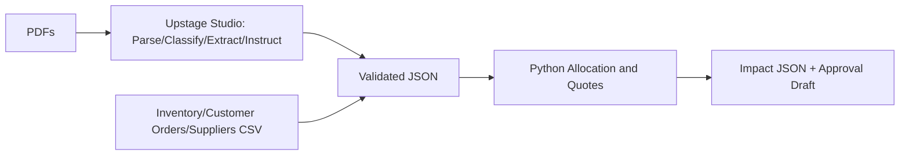

# LeadTime Guardian Agent

환경 이전 및 개발 재개: **[Chrome Work 인계 문서](docs/WORK_HANDOFF.md)**.

Python 안전성 V6의 최신 구현·검증·통합 계약: **[개발 보고서 및 팀 인계](docs/PYTHON_SAFETY_V6_HANDOFF.md)**.

**대구·울산·경북 대학 연합 X Upstage AI Agent Hackathon V.2**  
AI Agent 기반 납기 지연 영향 분석 및 구매 대응 자동화 시스템

> **현재 상태: 실제 Studio C001 v4 예측으로 Python 계산 재현, Python 3.11 회귀 189개·Ruff 통과.** C013 실제 결과는 미제공으로 검증 차단, C008/C017은 합성 정규화 계약만 검증했다. 실제 API 추론·PDF 근거 정확도·최종 제출은 미완료다.

## 무엇을 해결하나?
발주서·공급업체 지연 공지·대체업체 견적서를 읽어, 어떤 고객 주문이 언제 몇 개 부족해지는지 계산하고 납기 내 구매 대안을 제시한다. 사람이 최종 검토·승인하며 실제 메일 발송 및 발주 기능은 MVP에서 제외한다.



## 실행 환경
Python 3.11; Studio 권한 없이 **로컬 계산 예제**를 수행할 수 있음.

```bash
git clone https://github.com/knustu/leadtime-guardian-agent.git
cd leadtime-guardian-agent
python -m venv .venv
# Windows PowerShell: .\.venv\Scripts\Activate.ps1
# Linux/macOS: source .venv/bin/activate
pip install -r requirements-dev.txt
python scripts/run_demo.py              # 기존 단일 고객 주문 테스트
python scripts/run_portfolio_demo.py    # 신규 다수 주문/견적 테스트
pytest -q
ruff check .
```

합성 PDF 재생성 (ReportLab 및 한국어 TTF 폰트 필요): `pip install reportlab && python scripts/generate_synthetic_dataset.py`. 생성기는 운영 시 `FONT` 경로를 설치 환경에 맞게 바꿀 수 있다. 생성된 PDF·견적은 **실제 기업 자료가 아니다**.

## 프로젝트 자료
| 위치 | 역할 |
|---|---|
| `docs/PROJECT_PROPOSAL.md` | 문제/사용자/B·C 범위/성공 기준 |
| `docs/ARCHITECTURE.md` | 전체 데이터 흐름, 계약, 계산 책임 분리 |
| `docs/REQUIREMENTS.md` | FR/NFR, 난이도·인시·DoD |
| `docs/DATA_SPECIFICATION.md` | 합성 PDF/CSV/Gold/검증 방식 |
| `docs/AGENT_WORKFLOW.md` | Studio 노드와 복사 가능한 프롬프트 |
| `docs/PROJECT_PLAN.md` | 일정/WBS/인시/담당·완료 |
| `docs/TEAM_RULES.md` | Ground Rules / PR 보안 |
| `docs/SUBMISSION_CHECKLIST.md` | 미션 및 필수 제출물 검증 |
| `configs/schemas/*.json` | Python 정규화 입력·출력 계약 (Studio export 아님) |
| `src/leadtime_guardian/engine.py` | 다수 주문/입고/견적 계산 엔진 |
| `data/cases/SYN-C###/*.pdf` | 20케이스 x 3개의 **합성** 문서 |
| `data/gold/extraction_gold.json` | 문서별 정답 후보; 사람 원문 대조 필요 |

## 계산 모델 가정
제품별 단위는 EA, 화폐 KRW, 기준일 현재 재고는 미예약분, 고객 납기순으로 물량 배분, 부분 입고는 각각 입고행으로 나눔, 대체 구매안은 도착 기한 내 견적만. 계산은 결정론적이나 전역 최적 구매 알고리즘은 아직 아니다. 견적 공급량을 여러 주문에서 공유하고 사용한 견적당 운임을 한 번 계산한다. 실제 발주는 수행하지 않는다.

## 대회 일정(KST)
- 10/30 OT 및 Studio 권한 확인; 11/02 교육; 11/03 개인 Mission 1; 11/06 팀 Mission 2.
- 11/09 오피스아워; **11/10 17:00 내부 완료 목표**; **11/11 13:00 외부 제출(2026-10-22 수정 공지, OT/LMS 재확인)**.
- 11/12 본선 발표, 11/13 최종 데모데이. 세부 미션/업로드 규격은 운영진 교육에서 확정.

## Studio 주의

C001 문서와 연결 검증: [C001 integration checkpoint](docs/C001_INTEGRATION.md).
공식 API 실행 프로그램과 사전 점검: [Agents API runner](docs/AGENTS_API_RUNNER.md).
선택 설치는 `pip install -r requirements-agents.txt`이며, API 키는 로컬 환경변수로만 관리한다.
`python scripts/generate_c001.py`로 3개 합성 PDF를 생성하고,
`python scripts/analyze_studio_export.py --help`로 실제 출력 파일 연결 방법을 확인한다.
정답 후보·오프라인 계산과 실제 Studio 출력은 별도로 보관한다. 현재 이 연결 코드의
로컬 계약 테스트는 실제 Studio 실행이나 PDF 근거 검증을 의미하지 않는다.
공식 Studio는 Parse·Classify·Extract·Instruct·Validate·Merge·Match를 안내하며, 설정 JSON은 Studio export 기능으로 내보내야 한다. 이 프로젝트가 작성한 `configs/schemas`를 설정 export 파일로 제출하면 안 된다. Upstage 문서상 **Solar Pro 3는 2026-10-30 KST 완전 지원 종료 예정**, 새 모델은 Solar Pro 4 등 지원 대상 사용.

## 외부 참고 (2026-10-29 확인)
- [Upstage 노드 구성](https://console.upstage.ai/ko/docs/studio/key-features)
- [Upstage Agents API](https://console.upstage.ai/docs/agents)
- [Studio 설정 내보내기](https://console.upstage.ai/docs/studio/sharing)
- [Upstage 모델 지원 변경](https://console.upstage.ai/docs/capabilities/generate/reasoning)
- [경북대 공지 변경](https://aicollege.knu.ac.kr/bbs/board.php?bo_table=sub6_1_a&wr_id=29480)
- [울산대 상세 일정](https://ie.ulsan.ac.kr/ie/893?action=view&no=282626)

## 팀 인계 (2026-11-05 KST)

먼저 docs/PYTHON_SAFETY_V6_HANDOFF.md와 docs/member2_v6/VALIDATION_MATRIX.md를 읽으세요. Studio 설정 후보 검토는 docs/member2_v6/20261102_candidate_review/CONFIG_REVIEW.json을 참고하세요. 실제 Studio 예측과 PDF 근거 검증, C013 실제 출력 확보가 남았습니다. API 키는 .env.example을 참고하여 로컬 환경변수로 설정하세요. 2026-11-05 로컬 회귀 테스트: 189개 통과. 외부 API 및 Studio는 이번에 실행하지 않았습니다.
